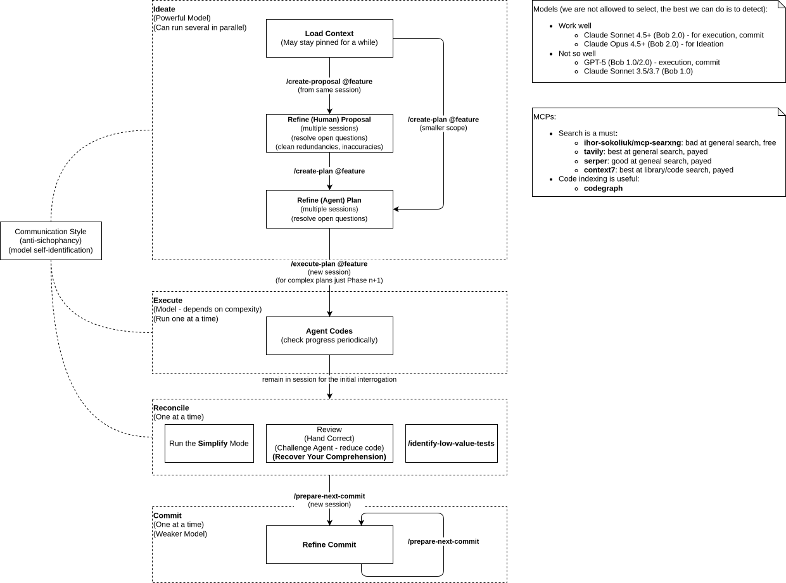

# Process

The workflow is fluid and curiosity-driven, not a pipeline. The diagram below sketches the phases and how they
connect; the sections that follow describe how the work actually flows through them.

## The scarce resource is attention

Agentic execution runs in the background, so human flow-state is spent not on typing code but on whichever layer
has the most leverage: architecture research, planning, or review. The whole process is about directing attention,
and that shapes every choice below.

Because ideation is fast and cheap while executing a plan is slow, ideas outrun execution and a backlog can form.
The process is built to tolerate that imbalance.

## The codebase compounds

You are never working on a blank page. The codebase evolves through many process loops, and each loop leaves
behind more than a finished feature — it leaves examples. The agent's next batch of code is only as good as the code
it can already see, so every loop is partly an investment in the next one: the cleaner and more regular the code you
leave behind, the more successfully the agent grows it.

Coding agents thrive on regularity and high quality; ambiguity in the existing code compounds into ambiguity
in the new. As the codebase grows and its principles become legible in the code itself, it gets *easier* to add to, not
harder. This is the virtuous loop: quality maintained now buys a higher success rate on every loop that follows.

Principles live at two scales. The larger ones — module boundaries, data formats, the shape of a component's behavior —
are captured in a `docs/architecture` document set that evolves over the life of the project. Early on those documents
are concrete and code-like: what modules should exist, what data flows between them, what exact behavior is expected.

As that knowledge is realized in code, the documents shed their specificity and harden into principle —
the enduring rules the code now embodies. The smaller-scale principles need no document at all; the code enforces
them by example, and the agent reads them straight from the source.

Neither the documents nor the code are ever perfectly in sync — in the real world both always drift somewhat.
Part of the work is keeping that gap small enough that the codebase stays a reliable teacher for the next loop.

## The code is the ground truth

The focus of the process is the code — and the code includes the `docs/architecture` documentation written for
humans. Together they are the source of truth: the enduring grounding from which every session begins and in which the
agent is grounded. Code is not the last-mile expression of some higher artifact; it is the durable asset the whole
process serves, and its architectural documentation is the part of it that speaks to people rather than to the
compiler.

Everything else the process produces is temporal. A proposal is future work — a design worth doing, captured but not
yet committed. A plan is past work — the record of a loop that has run. Each grounds the agent at a single point in
time and then ages out of sync, scaffolding that served its moment and can be discarded. They are point-in-time
grounding; the enduring grounding is the code and its architectural documentation, which the process keeps current
precisely because it is what the next loop is built on.

## The arc of a feature

A representative pass moves through four styles of work. Each uses a different interaction style and, where the model
can be detected, a different class of model.

### Load

Chat style, powerful model.

Every session starts with an intent — research a topic, fix a bug, implement a feature.
Within that goal the session may run long as both the human and agent understanding improves.
Here you load the problem constraints into context and use the agent to discover blind spots, so the
*Communication Style* is critical.

The agent helps in overcoming the initial mental hump of ramping up your attention to get into flow.

### Capture

When the context crystallizes, record it: `/create-proposal` for a design record worth doing, `/create-plan` for an
implementation plan detailed enough for an agent to build against. Crystallization is often a deliberate step — asking
the agent to summarize what has been discovered so far, which both consolidates the understanding and primes it for the
capture skill. Either or both may be produced; sometimes the capture happens and the work is set aside for later.

### Execute

Batch-job style; model chosen by complexity. `/execute-plan` steps through the plan's phases, creating and fixing tests
as it goes. This is the slow part, and it runs in the background while fresh ideation sessions start.

### Reconcile

Chat style, powerfule model.

Completing execution leads straight into the recover-quality phase rather than deferring it: review by hand,
challenge the agent to reduce code, run the `Simplify` mode, and use `/identify-low-value-tests` to prune weak
tests.

The goal is to fit the new code cleanly into the codebase — maintaining the principles the code embodies, and
sometimes syncing what changed back into the `docs/architecture` set so the larger principles keep pace. This is the
loop's investment in the next one: the quality maintained here is what the agent imitates next time.

Here the human repays the *comprehension debt* accumulated while not paying attention to the execution phase.

### Commit

Chat style, weaker model. `/prepare-next-commit` and `/prepare-single-commit` group changes into logical commits.
Commits summarize changes to the code, not features: one commit may span several features, or none cleanly.

## Running in parallel

The phases do not run strictly in order. A plan executes in the background while a new ideation session begins; a new
idea can spawn its own flow on the spot. Sessions are abandoned or carried forward as attention moves. Two tradeoffs
are accepted deliberately:

- Quality is the next loop's foundation. Backgrounding execution means the resulting code is not in your head;
  recover-quality is the one phase that is never deferred, because it keeps the codebase a reliable teacher for the next
  loop and, in the same act, recovers the comprehension that backgrounding cost you.
- Abandonment is a signal, not a failure. Ideation is meant to outrun execution, so some captured work is expected to
  be dropped. A visible, counted abandoned state is an honest scoreboard, not a mess to hide.

## Managing the backlog

Parallel, out-of-order flows accumulate a pile of proposals and plans. The acts of capture, execution, and commit say
nothing about the backlog as a whole: across everything captured, what exists, what stage is each at, and what needs
a decision. Without an answer, the forgotten middle rots — work that was captured or started, then left untouched
because a newer flow pulled attention away.

The `triage` skill closes this gap. It surfaces open work oldest-first, bucketed by age, and prompts a decision on what
has gone stale or is finished. It is the single place closing decisions are made, run as a deliberate clear-the-backlog
session rather than grafted onto another skill.

## Graphical prompting

Throughout, a draw.io diagram can act as a shared, mutable workspace between you and the agent — a prompt you both
reason about and evolve across turns. See [graphical prompting](graphical-prompting.md) for detail.
