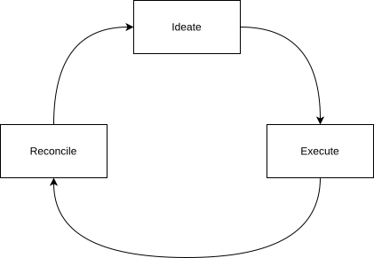
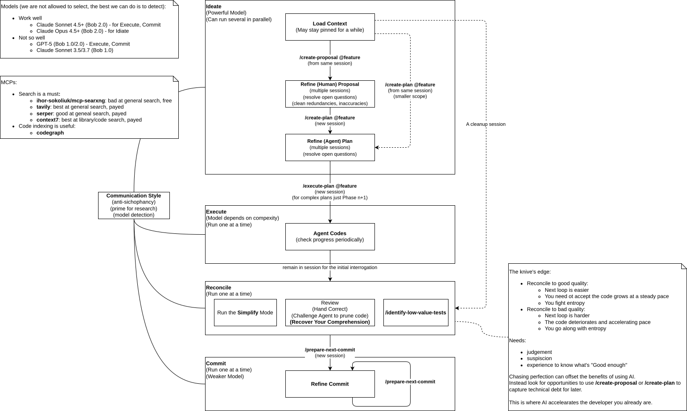

# Ratchet Process

## Principles

### The scarce resource is attention

The workflow's goal to improve the cognitive ability of a single developer.

The whole process is arranged to keep that attention at an optimal load:

- Ideation carries you over the initial hump of getting focused; starting cold is hard.
- Research and planning hold you at that high-leverage layer rather than dropping you into execution.
- Execution runs in the background, so the slow work costs little attention and keeps fatigue low.
- Reconciliation is unavoidable, but it timed to happen when the agent still holds context, so you can interrogate
  it about the code and switch focus more easily.
- The generated code is good enough to carry forward, so when you choose to hand-code you don't start cold.

Because ideation is fast and cheap while executing a plan is slow, ideas outrun execution and a backlog can form.
The process is built to manage this imbalance.

### The code is the ground truth

The process serves one durable asset: the code, and the `docs/architecture` prose that speaks its principles to
people. Every session begins grounded in the code rather than in some higher artifact the code merely expresses.

Its grounding principles live at two scales:

- High level — captured in `docs/architecture`. These are module boundaries and roles, data formats, enduring principles.
- Low level - what clean code looks like, libraries to prefer etc. These need almost no documentation, because
  the code enforces them by example.
  
The two morph over the lifetime of the project. At first there is no code so the architecture documents are much
more code-like. Not only module roles for example, but descriptions of exact module behavior with code snippets.
As this information is transfered into code the architecture documents solidify into a more structural description,
general behavior rules, actheicture decisions (transferred from proposals).

Everything else the process produces is temporal. A proposal captures a design worth doing, a plan its implementation;
each is only a point-in-time grounding — future intent when captured, present while the work runs, past once it has
run — that ages out of sync and can be discarded.

### The codebase compounds

You are never working on a blank page. Each loop leaves behind more examples for the agent.
Regularity and quality compound at a steady rate. Conversely ambiguity compounds technical debt at an accelerating rate.

So the quality maintained now buys a higher success rate on every loop that follows. As the codebase grows and its
principles become legible in the code itself, it gets *easier* to add to rather than harder.

The architecture documents and code never stay perfectly in sync, you can't spend each loop on both.
Part of the work is to keep the gap small enough so they complement rather than contradict.

## The arc of a feature

A representative pass moves through four styles of work. Each uses a different interaction style and, where the model
can be detected, a different class of model.

### Load

Chat style, powerful model.

Every session starts with an intent — research a topic, fix a bug, implement a feature.
Within that goal the session may run long as both the human and agent understanding improves.
Here you load the problem constraints into context and use the agent to discover blind spots, so the
*Communication Style* is critical.

### Capture

When the context crystallizes, record it: `/create-proposal` for a design record worth doing, `/create-plan` for an
implementation plan detailed enough for an agent to build against. Crystallization is often a deliberate step — asking
the agent to summarize what has been discovered so far, which both consolidates the understanding and primes it for the
capture skill. Either or both may be produced; sometimes the capture happens and the work is set aside for later.

### Execute

Batch-job style; model chosen by complexity.

The `/execute-plan` steps through the plan's phases. This is the slow part, and it runs in the background while fresh ideation sessions start.

### Reconcile

Chat style, powerful model.

Completing execution leads straight into the recover-quality phase rather than deferring it: review by hand,
challenge the agent to reduce code, run the `Simplify` mode, and use `/identify-low-value-tests` to prune weak
tests.

The goal is to fit the new code cleanly into the codebase — maintaining the principles the code embodies, and
syncing what changed back into the `docs/architecture` set so the larger principles keep pace. This is the
loop's investment in the next one: the quality maintained here is what the agent imitates next time.

Use `/reconcile-arch <slug>` to transfer a completed feature's architectural decisions into `docs/architecture`.
The skill reads the feature's proposal and plan, maps each decision against the existing architecture tree, and
produces a gap analysis in chat before writing anything. When the updates are confirmed it stamps
`arch-merged: <date>` on the feature record as a provenance timestamp.

Reconciliation is also where hand-coding fits, on the occasions you want it. The process never mandates writing code
yourself — in practice you rarely start there, using the agent to get into focus until that bleeds into agentic coding
on its own. But the loop is fluid, and the code it produces is a base rather than a blank page, so whenever you would
rather shape something by hand, this is the natural place to drop out of the agentic loop and do it.

Here the human repays the *comprehension debt* accumulated while not paying attention to the execution phase.

### Commit

Chat style, weaker model. `/prepare-next-commit` and `/prepare-single-commit` group changes into logical commits.
Commits summarize changes to the code, not features: one commit may span several features, or none cleanly.

## Running in parallel

The phases do not run strictly in order. A plan executes in the background while a new ideation session begins; a new
idea can spawn its own flow on the spot. Sessions are abandoned or carried forward as attention moves. Two tradeoffs
are accepted deliberately:

- Quality is the next loop's foundation. Backgrounding execution means the resulting code is not in your head;
  recover-quality is the one phase that is never deferred, because it keeps the codebase a reliable teacher for the next
  loop and, in the same act, recovers the comprehension that backgrounding cost you.
- Abandonment is a signal, not a failure. Ideation is meant to outrun execution, so some captured work is expected to
  be dropped. A visible, counted abandoned state is an honest scoreboard, not a mess to hide.

## Managing the backlog

Parallel, out-of-order flows accumulate a pile of proposals and plans. The acts of capture, execution,
and commit say nothing about the backlog as a whole: across everything captured, what exists, what stage
is each at, and what needs a decision. Without an answer, the forgotten middle rots — work that was captured
or started, then left untouched because a newer flow pulled attention away.

The `triage` skill closes this gap. It surfaces open work oldest-first, bucketed by age, and prompts a
decision on what has gone stale or is finished. It is the single place closing decisions are made, run as a
deliberate clear-the-backlog session rather than grafted onto another skill.

Triage output also flags open features that carry no `arch-merged` date as `[arch-pending]` — a second
actionable bucket alongside `[actionable]` (finishable). A feature can be triage-closed without being
arch-reconciled; not every feature warrants an architecture update. But the flag keeps it visible.

## Graphical prompting

Throughout, a draw.io diagram can act as a shared, mutable workspace between you and the agent —
a prompt you both reason about and evolve across turns. See [graphical prompting](graphical-prompting.md)
for detail.
