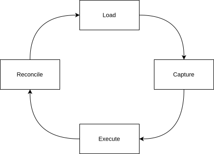
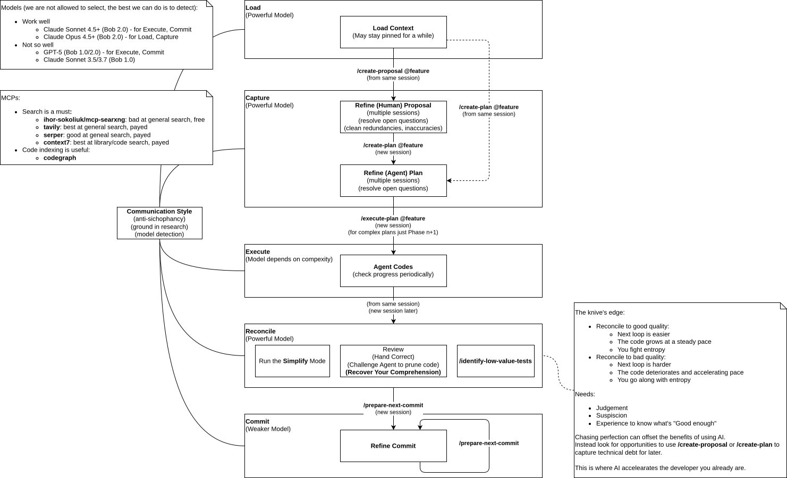

# Ratchet Workflow

> AI coding magnifies the developer you already are.
>
> The goal of this workflow is to improve your cognitive performance, the rest depends on you.

## Principles

The workflow runs in loops.

### The scarce resource is attention

The whole process is arranged to maintain focus:

- [Load](#load) carries you over the initial hump of getting focused; starting cold is hard.
- Research and planning keep you in the same thinking mode to maintain your momentum.
- [Execution](#execute) runs in the background, so the slow work costs little attention and keeps fatigue low.
- [Reconciliation](#reconcile) is unavoidable, but is timed to happen when the agent still holds context,
  so you can interrogate it about the code and switch focus more easily.
- The generated code is good enough to carry forward, so when you choose to hand-code you don't start from scratch.

### The code is the ground truth

The process produces two kinds of artifact: durable and temporal.

Durable artifacts are the code and the `docs/architecture` prose that explains its principles.
Every loop begins from these — they are not derived from a higher-level spec, they *are* the spec.

Temporal artifacts are proposals and plans. A proposal captures a design worth pursuing; a plan
details how to build it. Each is authoritative only for the duration of its use: future intent
when written, a working contract during execution, scaffolding to discard once the code exists.
This is the opposite of spec-driven development, where the spec is the authority and the code a derivative of it.

Architecture documents occupy a middle ground. Early in a project they read like specifications —
exact behavior descriptions, code snippets, module contracts. As that detail transfers into code,
they solidify into structural concerns: module boundaries, general behavior rules, architecture
decisions absorbed from closed proposals.

### The code compounds

You are never working on a blank page. The agent reads the existing codebase on every loop, and it imitates what it finds.
Good code teaches the agent good patterns; inconsistent code teaches it noise.

This means quality compounds in both directions:

- Maintain it and each loop gets easier as the agent has better examples to follow.
- Let it slip and each loop gets harder as the agent amplifies the technical debt.

Architecture documents that contradict the code degrade rather than improve agent performance.

## The arc of a feature

A representative pass moves through four styles of work. Each uses a different interaction style and is suitable for
a different class of [model](models.md).

### Load

Chat style, requires a powerful model.

Every session starts with an intent — [research a topic](tools.md), fix a bug, implement a feature.

Within that goal the session may run long as both the human and agent understanding improves.
Here you load the problem constraints into context and use the agent to discover blind spots, so the
[Communication Style](../../bob/rules/communication-style.md) is critical.

### Capture

Capture happens at the tail end of a Load session and inherits its model.

When the context crystallizes, record it: `/create-proposal` for a design record worth doing, `/create-plan` for an
implementation plan detailed enough for an agent to build against.

Crystallization is often a deliberate step — asking the agent to summarize what has been discovered so far.
This both consolidates your understanding and primes the agent for the respective capture skill.

### Execute

Batch-job style; can tolerate weaker models for simpler tasks.

The `/execute-plan` steps through the plan's phases. You are free to start new Load sessions.

When execution completes you must go directly to [reconcile](#reconcile) within the same agent session — don't defer.

### Reconcile

Chat style, requires a powerful model.

This is the knife's edge, where you invest in the next loop:

- Reconcile to good quality and the next loop is easier — ratchet forward.
- Let quality slip and the next loop is harder — ratchet backward.

This work requires judgement, suspicion, and experience to know what is "good enough".

- Challenge the agent to explain code, remove redundancies, refactor to better patterns, explain edge cases.
- Run the `Simplify` mode
- Run `/identify-low-value-tests` — agents often create large amounts of near-useless tests
- Run `/reconcile-arch` to transfer completed architecture decisions to `/docs/architecture`
- Use `/create-proposal` or `/create-plan` to capture discovered work for later.

This is a natural point to drop into hand-coding. The agent produces code that hits the right APIs and has the structure
you want; it is easier to start from that, clean it, and take it forward rather than to begin from scratch.

### Commit

Chat style, suitable for weaker models.

Use `/prepare-next-commit` and `/prepare-single-commit` to group changes into logical commits.
Commits summarize changes to the code, not features: one commit may span several features, or none cleanly.

## Running in parallel

The phases do not run strictly in order. You can park or pick up flows whenever the prerequisites for the next step
are available.

This is especially true for Load — start a new flow as soon as you have an idea to capture,
a question to research, an edge case to explore, etc. Conversely avoid running more than one execution at a time,
because you may find it hard to re-focus on reconciliation when execution ends.

The tradeoffs of this approach are:

- **Comprehension debt:**
  Backgrounding execution means the resulting code is not in your head as you work on something else.
  When the plan is done you no longer have good understanding of what the code does.
  To mitigate this, [reconcile](#reconcile) cannot be deferred, unlike other phases.
  It is done right after execution while you still have some recent context from examining the plan and
  the agent has peak context because it is just finished executing the same plan.
- **Abandoned work:**
  Load has to be rapid and unrestrained to explore the problem space effectively;
  capturing work and abandoning it as the implementation catches up is an acceptable cost.

## Managing the backlog

Parallel, out-of-order flows accumulate a pile of proposals and plans. Left unmanaged, the pile develops a forgotten
middle — work that was captured or started, then left untouched as newer flows pulled attention away.

The `triage` skill closes this gap. It surfaces open work oldest-first, bucketed by age, and prompts a
decision on what has gone stale or is finished. It is the single place closing decisions are made. Run it as
a deliberate clear-the-backlog session.

Triage output also flags open features that carry no `arch-merged` date as `[arch-pending]` — a second
actionable bucket alongside `[actionable]`. A feature can be closed without being arch-reconciled;
not every feature warrants an architecture update. But the flag keeps it visible.
