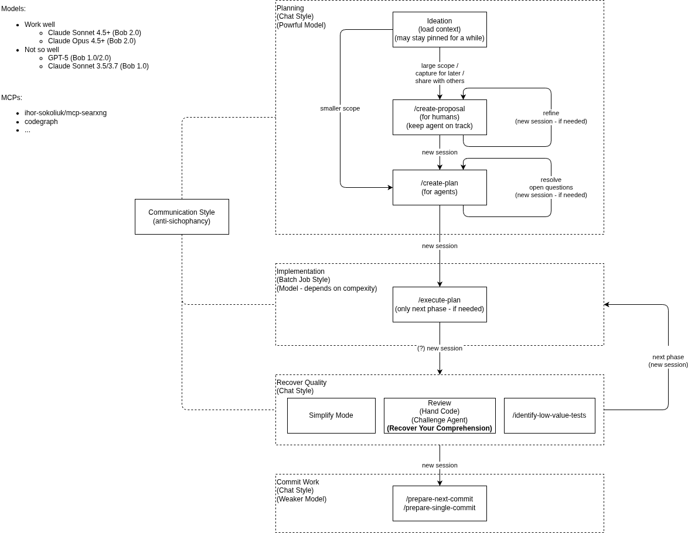

# Process

The Bob workflow is illustrated in the diagram below:

## Graphical Prompting

Draw.io diagrams can serve as a **shared mutable workspace** between you and the agent — not just a static prompt, but something you both reason about and evolve across turns.

### How it works

Reference the `.drawio` file in your message (e.g. `@coding-agent-flow.drawio`). The agent reads the raw XML directly —
no special skills needed — and reasons about the graph structure, labels, and relationships as structured data.

The interaction is bidirectional: you edit the diagram in response to the agent's output; the agent reads the updated
file in the next prompt and continues from the new state. The diagram accumulates decisions and corrections like a collaborative whiteboard.

### Practical uses

- **Specify what to build** — draw a component diagram, sequence diagram, or flow; the agent implements against it
- **Audit code against intent** — share the intended architecture and ask whether the current codebase matches; gaps surface quickly
- **Iterative design** — challenge the agent's interpretation, update the diagram to correct it, re-prompt

The **Bob's Take** section below is a direct example: the agent was pointed at [`coding-agent-flow.drawio`](coding-agent-flow.drawio) rather than a text description.

## Parallelism

The workflow is parallel but human-bounded. Multiple ideation sessions can run concurrently with an execution phase, but the **Recover Quality** phase requires the human to be in-mental-context from the implementation — that shared context is what makes review fast and can't be delegated.

This is a deliberate rejection of the **agent-factory / auto-PR** pattern:

> "If I see a PR opened by an agent I have to enter in-mental-context again and start a slow chat loop through PR comments — which is less effective than being present during implementation."

The cost of re-entering context via PR review exceeds the benefit of full automation.

---

## Takes

Two assessments of this workflow live in their own files:

- [Bob's Take](bobs-take.md) — generated by the coding agent (Claude Sonnet 4.5) from the diagram alone, as a smoke test
- [Opus's Take](opus-take.md) — a second opinion from a more powerful model (Claude Opus 4.8)
